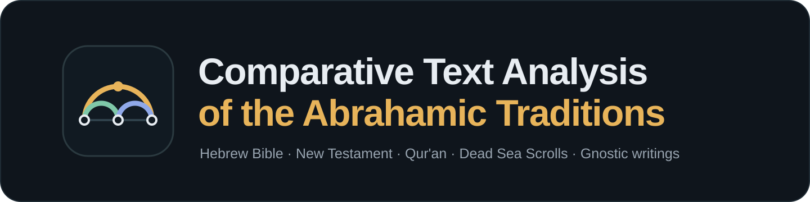

<p align="center">
  
</p>

<p align="center"><b>A free, open research workspace for reading the Abrahamic texts side by side, computationally, and saying plainly what the evidence does and does not show.</b></p>

<p align="center">
  
  
  
  
  
  
</p>

<p align="center">
  <a href="ROADMAP.md">Roadmap</a> ·
  <a href="docs/scope.md">Scope</a> ·
  <a href="docs/research-questions.md">Research questions</a> ·
  <a href="docs/architecture.md">Architecture</a> ·
  <a href="SOURCES.md">Sources and licenses</a> ·
  <a href="docs/licensing-and-ethics.md">Ethics</a> ·
  <a href="CHANGELOG.md">Changelog</a> ·
  <a href="CONTRIBUTING.md">Contributing</a>
</p>

---

> **Status: setup stage.** This repository holds the plan, the source manifest with license records, and the fetch tooling. **No texts have been downloaded and no analysis has been run yet.** Every capability described below is planned, not built. The [roadmap](ROADMAP.md) tracks what is done, and its boxes are ticked only when the work exists and has been checked.

## What this is

Abrahamic Texts Lab is a personal, non-profit research project that will grow into three things:

1. **A corpus.** The Hebrew Bible, New Testament, Qur'an, Dead Sea Scrolls, Apocrypha and Pseudepigrapha, and Gnostic writings (Nag Hammadi and related), in their original languages and in open translations, with verse-level identifiers, aligned editions, and a recorded license for every text.
2. **A set of analyses** over that corpus: textual reuse, stylometry, how concepts shift, and recurring motifs, plus tools for low-resource ancient languages (Coptic first).
3. **A public web app** that lets anyone browse the texts and the findings through readable visualizations, with the evidence and the uncertainty shown beside every claim.

It is built for anyone curious about these traditions and their texts, and structured so it can also support an academic submission to a computational-humanities venue.

## What it is not

- **Not a religious authority or a judge of any tradition.** The framing is descriptive: how texts relate, reuse one another and use language. It never ranks traditions or says which is right.
- **Not a commercial product.** It is free, and several of its sources only permit non-commercial use, so it must stay that way.
- **Not a replacement for scholars.** Machine output is a lead for readers, not a verdict. Annotation and gold-set claims need review by a domain expert before being presented as findings.

## The research spine

Nine research directions share one backbone. To keep the work a question and not just a corpus, they are anchored to a single thread:

> **How is the Genesis and creation tradition reused and transformed across Jewish, Christian, Gnostic and Qur'anic texts?**

| # | Direction | Role in the spine |
|---|---|---|
| R1 | Unified, cleaned, aligned corpus | The foundation everything else reads from |
| R2 | Parallel passages and intertextuality detection | The core engine: where do texts quote or rework each other? |
| R3 | Low-resource tooling for Coptic (then Syriac) | Needed to read and align the Gnostic texts at all |
| R4 | Computational stylometry, authorship and dating | Where do texts fall relative to scholarly consensus? |
| R5 | Concept evolution via diachronic embeddings | How do light, spirit, wisdom and logos shift across traditions and periods? |
| R6 | Theme, argument and motif mining | Creation, dualism and the demiurge, validated by scholars |
| R7 | Long-context scripture benchmark | Questions that need reasoning across the whole corpus |
| R8 | How LLMs handle religious texts | Memorization versus reasoning, consistency across translations, descriptively framed |
| R9 | RAG scholarly research assistant | Answers with exact verse citations and a faithfulness evaluation |

Each direction has a question, data needs, a method, an evaluation and stated limits in [docs/research-questions.md](docs/research-questions.md), and a tickable checklist in the [roadmap](ROADMAP.md). All nine are currently **not started**.

## Planned web app

A reading-and-findings site, mostly static (precomputed results, cheap to host) with a small server only for search and the assistant. Planned views:

- **Parallel reader:** synoptic-style columns for Hebrew, Greek, Coptic, Arabic and English with reuse highlighted.
- **Cross-reference arcs:** links between passages across traditions, filterable by tradition and confidence.
- **Reuse flow:** Sankey or chord diagrams of how material moves between texts.
- **Passage map:** a 2D embedding map of passages, colored by tradition, linked to the text.
- **Stylometry:** dendrograms and clustering with bootstrap support.
- **Concept drift:** how a term's contexts change across periods.
- **Evaluation results:** heatmaps for the LLM benchmark and the RAG faithfulness study.
- **Assistant:** questions answered with verse-level citations.

Every view shows its data source, license, and uncertainty. See [docs/architecture.md](docs/architecture.md).

## Sources

Thirteen candidate sources are recorded in [SOURCES.md](SOURCES.md) and [data/sources.toml](data/sources.toml), each with its license and a status (`ready`, `verify`, `manual` or `blocked`). Three license constraints shape the project: some data is **non-commercial only**, some is **ShareAlike**, and the Tanzil Arabic text must be kept **verbatim**. Third-party texts are never committed to this repository; the fetch script retrieves them from their original sources.

Known gaps are stated openly: there is no clean open edition of the Gospel of Judas yet, only part of Nag Hammadi exists in an open Coptic corpus, and the Septuagint and several translations still need verification.

## Repository layout

```
assets/                  logo and banner
data/sources.toml        machine-readable source manifest
data/raw/                fetched third-party texts (git-ignored)
docs/                    scope, research questions, architecture, ethics
scripts/fetch_sources.py dry-run by default; --execute downloads
tests/                   manifest checks
ROADMAP.md  CHANGELOG.md  CLAUDE.md  CONTRIBUTING.md  SOURCES.md
```

## Quick start

Python 3.11+, standard library only for now.

```bash
python3 scripts/fetch_sources.py                            # dry run: prints the plan, downloads nothing
python3 scripts/fetch_sources.py --execute hebrew-morphhb   # fetch one source
python3 -m unittest discover -s tests                       # check the manifest
```

Only sources marked `ready` are fetched.

## Principles

- **Descriptive, not evaluative.**
- **Provenance everywhere:** source, license, retrieval time and checksum for every text; evidence and uncertainty for every finding.
- **No fabricated results or citations.** If something was not run, it is stated as not run, and negative results are reported.
- **Free resources only.** No paid services are required.
- **Open by default,** within each source's license.

## Contributing and citing

Corrections to texts, sources, licenses and annotations are welcome, especially from scholars of religious studies and ancient languages. See [CONTRIBUTING.md](CONTRIBUTING.md). A citation entry will be added when there is something to cite.

## License

Code and original documentation: MIT ([LICENSE](LICENSE)). **Third-party texts and datasets are not covered by it** and keep their own licenses, listed in [SOURCES.md](SOURCES.md). Nothing here is legal advice.
